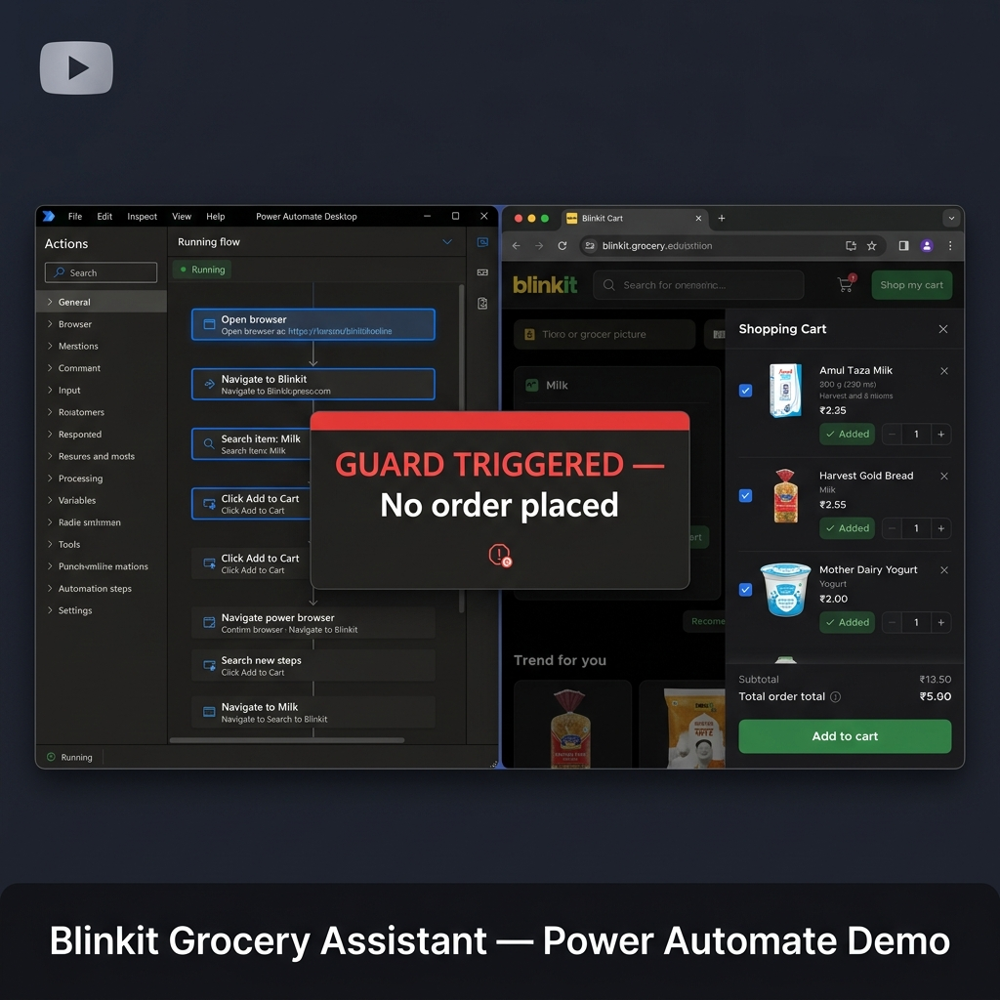

# Blinkit Grocery Assistant
### Power Automate Desktop Flow | Gigacore Energy Internship Assignment

<div align="center">
  <a href="https://drive.google.com/file/d/1EYdc1V73cb7zr01nX0HSVIY2IgRyE5t2/view?usp=sharing">
    
    <br/>
    <b>▶ Click to Watch Demo Recording (Google Drive)</b>
  </a>
</div>

---

## Overview

This project is a browser automation flow built with **Power Automate Desktop (PAD)** that acts as a grocery shopping assistant for [Blinkit](https://blinkit.com). The flow reads a configurable item list, navigates the real Blinkit website, compares product prices, adds the cheapest qualifying product per item to the cart, checks the total against a budget, and generates a shopping summary — **without ever placing an order or initiating payment**.

Notifications are sent via **Gmail (SMTP)** and **WhatsApp Web** at the end of each run.

### What the flow does, step by step:
1. Reads `config/items.csv` (item list with max price per item) and `config/settings.json` (address, budget, recipients)
2. Opens Blinkit in Microsoft Edge and waits for login confirmation if needed
3. For each item: navigates directly to `blinkit.com/s/?q=<item>`, scans all visible ADD controls, and picks the **cheapest product at or below the configured max price**
4. Clicks the ADD control for the chosen product; handles variant/option popups by picking the cheapest valid size
5. After all items are processed, opens the cart and reads the grand total
6. Compares cart total to budget; displays an over-budget warning if exceeded
7. Runs a **checkout guard** that stops the flow immediately if any payment/checkout element is detected on screen
8. Generates `output/summary.txt` (full) and `output/summary_short.txt` (WhatsApp version)
9. Sends the full summary to Gmail and the short version to WhatsApp Web (Brave browser)
10. **No order is placed. Enforced by the checkout guard in the flow.**

---

## Project Structure

```
grocery-assistant/
├── README.md                        ← setup and run instructions (this file)
├── .env.example                     ← template showing which secrets are needed
├── .gitignore                       ← excludes .env, output/, secrets
├── config/
│   ├── items.csv                    ← shopping list: item, qty, max_price per unit
│   └── settings.json                ← delivery address, budget, recipient config
├── flows/
│   ├── Main.txt                     ← reference pseudocode for Main subflow
│   ├── ShoppingProcess.txt          ← reference pseudocode for ShoppingProcess subflow
│   ├── SendEmail.txt                ← reference pseudocode for SendEmail subflow
│   ├── SendWhatsApp.txt             ← reference pseudocode for SendWhatsApp subflow
│   └── ErrorHandler.txt             ← reference pseudocode for ErrorHandler subflow
│   NOTE: The actual runnable flow is in PAD's internal storage.
│         Export it from PAD → File → Save → share the .robin/.zip file.
│         These .txt files are architecture reference only.
├── scripts/
│   ├── send_email.py                ← sends email via Gmail SMTP (Python stdlib only)
│   └── check_env.ps1                ← pre-run environment validator
├── docs/
│   ├── blueprint.md                 ← architecture diagram, variable table, selector reference
│   ├── test_plan.md                 ← test cases with expected results and actual results
│   └── pad_build_guide.md           ← click-by-click PAD subflow build guide
├── output/                          ← auto-created on first run
│   ├── summary.txt                  ← full shopping summary
│   ├── summary_short.txt            ← short version for WhatsApp
│   ├── run_log.txt                  ← timestamped step log
│   └── screenshots/                 ← auto-named screenshots per run
└── recording_script.md              ← shot-by-shot guide for the demo recording
```

---

## Design Decisions

### Modular Subflow Architecture
The flow is split into 5 independent subflows. `Main` is a pure orchestrator that reads config, sets path variables, and calls subflows in sequence. No logic is duplicated across subflows.

### Product Selection Rule
For each item, the flow uses JavaScript injection to scan all visible ADD controls on the Blinkit search results page (`/s/?q=<item>`). It finds the product card ancestor of each ADD control, extracts the selling price (lowest price shown, which accounts for struck-through MRP), and filters to items at or below `max_price`. The **cheapest qualifying product** is selected and added. If no product is within budget, the item is skipped and recorded as SKIPPED.

### JavaScript in PAD — Critical Note
PAD's `Run JavaScript function on web page` action requires the function to be named **`ExecuteScript`** exactly. Any other function name causes PAD to return the function object as the result variable instead of the string return value. All five JS actions in ShoppingProcess use this name.

### Blinkit ADD Controls Are `<div>` Elements
Blinkit does not use HTML `<button>` elements for ADD to cart. They use styled `<div>` or `<span>` elements. The JS scans `document.querySelectorAll('*')` and checks `.innerText === 'ADD'` to locate them.

### Variable Extraction from CSV
DataRow column values are extracted using PAD `Set variable` actions (`%v_row['item']%`, `%v_row['qty']%`, `%v_row['max_price']%`) rather than PowerShell scripts. PowerShell's `Write-Output` appends `\r\n` which, if captured by PAD, causes URLs like `blinkit.com/s/?q=milk%0D%0A` — this opens the autocomplete dropdown instead of the search results page.

### Search Navigation
The flow navigates directly to `https://blinkit.com/s/?q=<item_name>` rather than typing into the search bar. This avoids autocomplete dropdown interference and gives a clean, fully-loaded results page.

### Checkout Guard
After all items are processed and the cart is reviewed, a JavaScript guard scans the page for any checkout or payment-related elements. If found, the flow stops immediately and logs `DANGER`. This runs on the cart page so even the "Proceed To Pay" button triggers it — which correctly demonstrates the safety mechanism. **No purchase can be made.**

### Error Handling
Every risky action block is wrapped with PAD `On block error`. On failure: the step name and error message are logged to `run_log.txt`, a screenshot is captured. The flow never crashes silently.

### Security
No credentials are stored in any project file. Gmail credentials are loaded exclusively from Windows environment variables (`GMAIL_USER`, `GMAIL_APP_PASSWORD`). The `.env` file is in `.gitignore` and excluded from submission.

### WhatsApp Browser
WhatsApp Web is opened in **Brave browser** (where the user is logged in). All Blinkit automation runs in **Microsoft Edge**. These are separate — no conflict.

---

## Prerequisites

### 1. Power Automate Desktop
- Download free from Microsoft Store: search **"Power Automate"** or go to https://aka.ms/pad
- Sign in with any Microsoft account
- Install the browser extension for Edge when prompted

### 2. Browsers
- **Microsoft Edge** — all Blinkit automation (must be logged into Blinkit before running)
- **Brave** — WhatsApp Web (must be logged into WhatsApp Web before running)

### 3. Python 3.x
- Check: open Command Prompt → `python --version`
- If missing: download from https://python.org (tick "Add to PATH")

### 4. Gmail App Password
1. Visit https://myaccount.google.com/security
2. Enable **2-Step Verification**
3. Go to **Security → App Passwords → Create** → name it "PAD"
4. Copy the 16-character password

### 5. Set Environment Variables
Open **Command Prompt as Administrator** and run:
```cmd
setx GMAIL_USER "your_email@gmail.com"
setx GMAIL_APP_PASSWORD "xxxx xxxx xxxx xxxx"
```
Then **restart PAD** for the variables to take effect.

---

## Configuration

### `config/items.csv`
```csv
item,qty,max_price
milk,1,80
bread,1,60
yogurt,1,50
```
- `item` — search term used on Blinkit (lowercase, no spaces)
- `qty` — quantity (currently informational; flow adds 1 of the chosen product)
- `max_price` — maximum price in Rs per unit; items above this are skipped

### `config/settings.json`
```json
{
  "delivery": {
    "address": "Kondhwa Khurd, Pune",
    "pincode": "411048"
  },
  "budget_inr": 300,
  "recipients": {
    "email": "guddetigaurav1@gmail.com",
    "whatsapp_number": "917276082005"
  }
}
```

---

## Running the Flow

1. Open **Microsoft Edge** → go to `blinkit.com` → confirm you are logged in
2. Open **Brave** → go to `web.whatsapp.com` → confirm chats are loaded
3. Open **Power Automate Desktop**
4. Open the **Blinkit Grocery Assistant** flow
5. Click **Run (▶)**
6. When the PAD dialog appears asking if Blinkit home page is visible → click **OK**
7. Flow runs (~5–8 minutes for 3 items)
8. Check `output/summary.txt`, Gmail inbox, and WhatsApp

### Test Over-Budget Path
Set `budget_inr` to `50` in `settings.json` → run → flow shows "Over Budget" warning. Reset to `300` after.

### Test Item Over Max Price
Set `milk` `max_price` to `1` in `items.csv` → milk will be skipped with status `SKIP`. Reset after.

---

## Output Files

| File | Contents |
|------|----------|
| `output/run_log.txt` | Timestamped log: search results, add status, cart total, email/WA result |
| `output/summary.txt` | Full summary: run time, address, items added, cart total, budget status |
| `output/summary_short.txt` | One-line summary sent to WhatsApp |
| `output/screenshots/search_milk.png` | Screenshot after milk search loads |
| `output/screenshots/search_bread.png` | Screenshot after bread search loads |
| `output/screenshots/search_yogurt.png` | Screenshot after yogurt search loads |
| `output/screenshots/cart_before.png` | Cart sidebar screenshot before total read |

---

## Troubleshooting

| Problem | Solution |
|---------|----------|
| `ADD` button not found | Wait time too short — increase Wait at Line 11 in ShoppingProcess from 10s to 15s |
| Cart total shows Rs0 | GetCartTotal JS failed — check run_log for DIAG entries; page may not have loaded |
| Email not sending | Check `GMAIL_USER` and `GMAIL_APP_PASSWORD` env vars; regenerate App Password |
| WhatsApp not sending | Open Brave → check WhatsApp Web is logged in; increase Wait in SendWhatsApp |
| Blinkit shows CAPTCHA | Run in attended mode — solve CAPTCHA manually, click OK in PAD dialog |
| `[object Object]` in logs | JS function must be named `ExecuteScript` exactly — do not rename |
| URL shows `%0D%0A` | v_item_name has trailing newline — use Set variable instead of PowerShell for CSV columns |

---

## Selector Reference

| Element | Method Used | Note |
|---------|-------------|------|
| Blinkit search results | `Go to web page` with `/s/?q=<item>` URL | Direct URL, no search bar typing needed |
| ADD controls | `document.querySelectorAll('*')` + `innerText === 'ADD'` check | Blinkit uses `<div>` not `<button>` for ADD |
| Product price | Ancestor walk up DOM, regex `\u20B9\s*(\d+)` | Uses Unicode escape for ₹ symbol |
| Cart button | Class name substrings: `CartIcon`, `Cart`, `cart` | Opened via JS after loop |
| Cart total | Page innerText regex: `\u20B9(\d+)\s*\n?\s*TOTAL` | Falls back to largest price on page |
| WA compose box | `div[data-testid="conversation-compose-box-input"]` | Standard WhatsApp Web selector |

---

## Pre-Submission Checklist

- [ ] No passwords in any `.json`, `.csv`, `.txt`, `.py`, or `.ps1` file
- [ ] `.env` file is NOT in the submission folder (only `.env.example`)
- [ ] `run_log.txt` does not contain credentials
- [ ] Screenshots do not show browser autofill or saved passwords
- [ ] `output/summary.txt` is present with correct cart total and timestamp
- [ ] Recording shows: items added → cart total → guard → email sent → WA received
- [ ] PAD flow exported as `.zip` or `.robin` file and included

---

## Submission

1. Export flow from PAD: **File → Save** (PAD saves internally); to share: **right-click flow → Export → save `.zip`**
2. Zip the entire project folder — name it `grocery-assistant-gaurav-guddeti.zip`
3. Remove `.env` from the zip (`.env.example` stays)
4. Upload to Google Drive → Share → "Anyone with the link" → Viewer
5. Copy the link and submit

---

## Assumptions

1. Product selection: cheapest in-stock item at or below `max_price`. If none qualifies, item is skipped and recorded with status `SKIP`.
2. Blinkit account: must be logged in on Edge before running (OTP login handled manually via PAD dialog).
3. WhatsApp account: must be logged in on Brave browser before running.
4. No headless browser: visible window to reduce detection risk and allow manual intervention.
5. Checkout guard: scans page for checkout/payment-related elements after cart review. Triggers on "Proceed To Pay" in the cart sidebar — this is intentional and correctly demonstrates the safety feature.
6. Budget check: informational — the flow warns and logs but does not remove items from cart.
7. City: Pune (Kondhwa Khurd, pincode 411048).
8. Timestamps: local machine time (IST).
9. WhatsApp: personal number only (self-notification).

---

## Known Limitations & Honest Notes

| Limitation | Impact |
|-----------|--------|
| Blinkit class names are obfuscated | If Blinkit deploys a new version, ADD detection may break |
| ADD detection uses `innerText === 'ADD'` | "ADD with 2 options" is also handled; quantities >1 not yet automated |
| Cart total read uses page innerText regex | If Blinkit changes cart layout, strategy 1 and 2 may fall back to strategy 3 (largest price) |
| WhatsApp send uses web.whatsapp.com deep link | Depends on Brave being open and logged in; timing-sensitive |
| Checkout guard triggers on cart page | This is by design — demonstrates the guard works |
